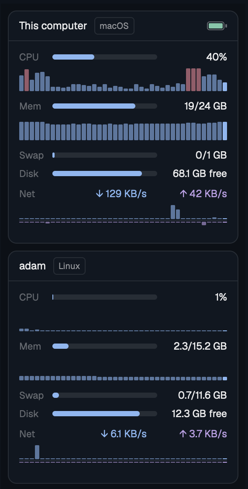
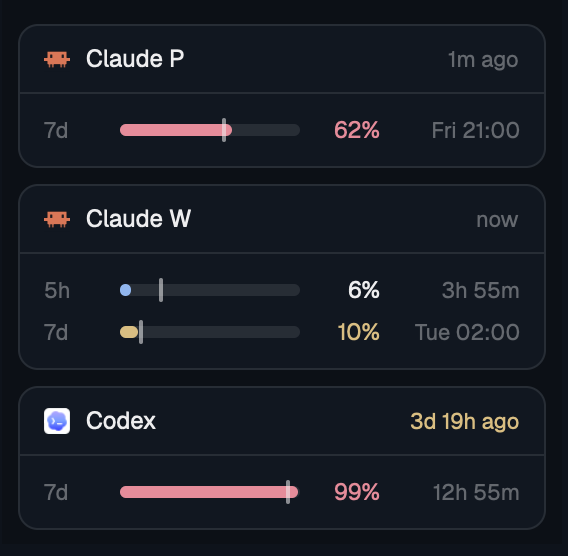
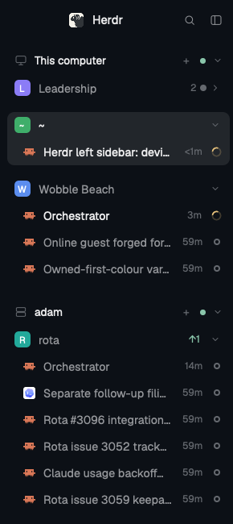
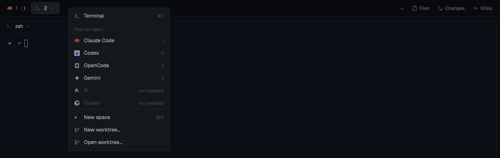

# herdr-mods

Five mods for the [Herdr](https://herdr.dev) desktop app. Vitals and limits sit together in one side panel tab in my layout, limits-bar shows the same limits in the status bar; spaces-plus is my left sidebar and tabs-bar-rightclick my tab bar.

Each mod has its own folder with a `RECIPE.md`, the brief an agent can build it from, and the files under `mods/<name>/`.

## vitals



One card per machine: this computer first, then every machine connected in Herdr.

Each card shows CPU, memory, swap, disk and network. CPU, memory and network also have a small graph of the last 40 samples. On a Mac the headline shows the battery, and a click on the local card opens Activity Monitor. Hover the CPU row to see the three busiest processes.

It samples every 3 seconds while the Herdr window is in front and the tab is visible, and every 30 seconds otherwise. Each sample is one shell call per machine. macOS and Linux are supported.

"Visible" is read from the layout: the mod looks for a block with the id `panel` that is not hidden and a `panel-body` whose active tab is `vitals`. With other ids it still works, at the 30 second rate.

Network counts physical interfaces only (`en*` on macOS; on Linux everything except loopback, Docker, bridges and VPN tunnels), so VPN traffic is not counted twice.

## limits



Subscription usage for Claude accounts and Codex, as bars with a pace mark and the reset time. A click opens the usage page.

Claude accounts are the config folders `~/.claude` and `~/.claude-*` that have a `settings.json` and a `projects` folder. The card label is "Claude" plus the first letter after the dash. `~/.claude` only gets a card when it has a login.

No status line is needed. Every 5 minutes at most, the mod asks the usage endpoint that Claude Code itself uses (`api.anthropic.com/api/oauth/usage`). For that it reads the account's OAuth token: from the Keychain item `Claude Code-credentials` on macOS, or from `.credentials.json` in the config folder elsewhere. Read `SCRIPT` in `limits/mods/limits/data.js` before you install this; it is about 50 lines of shell. Things to know:

- The token goes to curl on stdin and to Anthropic only. It is never printed or written to disk.
- The endpoint is not documented and may change. After a failed request the mod waits (the server's `Retry-After`, else 5 minutes) before it tries again.
- The mod does not refresh tokens. When a token has expired, the numbers stay old until Claude Code runs again for that account.
- macOS may ask once whether `security` may read the Keychain item.

The result is cached in `/tmp/claude/statusline-usage[-<hash>].json`, where `<hash>` is the first 8 hex characters of the SHA-256 of the config folder path. If your status line already writes that file (with `five_hour` and `seven_day` objects that hold `utilization` and `resets_at`), the mod uses it and makes no request while the file is younger than 5 minutes.

Codex limits are read from the newest rollout file under `~/.codex/sessions`. No request is made for Codex.

## spaces-plus



One sidebar in place of Herdr's two lists (spaces and agents). Devices hold spaces, and each space shows its agents right under it: pinned first, then blocked, done, working, idle. Spaces keep the order you drag them into.

Spaces and devices fold. A folded one shows how many agents are inside and a dot in the color of the most urgent one. A space with no agents says "no agents"; a click there opens a terminal tab in that space. Hover an agent to pin or unpin it. `agent.next` and `agent.prev` follow the list. In the narrow rail each space number gets a dot when an agent inside needs a look.

It is a clone of Herdr's shipped `spaces` mod with the agent rows of the shipped `agents` mod ported in, so dragging, worktree nesting, git info and device reconnect work as before.

## limits-bar


The limits as one line in the bottom status bar: per Claude account and Codex the icon, the name and, per window, a small bar with the percent used. Hover for reset times and pace, click for the usage page. It reads the same data as limits (same script, same cache), so you can show both.

## tabs-bar-rightclick



Herdr's tab bar, with a right-click on the empty bar next to the tabs opening the same "new" menu as the `+` button. A right-click on a tab still opens the tab's own menu. It also remembers the side panel (Files, Changes, Vitals) per space and adds a Vitals button.

## Install

```sh
git clone https://github.com/l4ci/herdr-mods.git
cd herdr-mods
./install.sh
```

The script links `vitals/mods/vitals`, `limits/mods/limits`, `limits-bar/mods/limits-bar`, `spaces-plus/mods/spaces-plus` and `tabs-bar-rightclick/mods/tabs-bar-rightclick` into `~/.config/herdr-app/mods`. All five have `"place": "none"`, so they show up only where a layout names them:

```json
{ "id": "vitals", "type": "column", "children": [
  { "id": "vitals-machines", "type": "block", "size": { "weight": 1 }, "content": { "mod": "vitals" } },
  { "id": "limits", "type": "block", "size": { "px": 260 }, "content": { "mod": "limits" } }
] }
```

For spaces-plus, replace the sidebar's spaces and agents blocks (in the shipped `main` layout, the `sidebar-lists` column) with:

```json
{ "id": "sidebar-list", "type": "block", "content": { "mod": "spaces-plus" }, "size": { "weight": 1 }, "min": 90 }
```

For limits-bar, make the status block a row with the status and the bar:

```json
{ "id": "status", "type": "row", "size": { "px": 28 }, "children": [
  { "id": "status-main", "type": "block", "content": { "mod": "workspace-status" }, "size": { "weight": 1 } },
  { "id": "limits-bar", "type": "block", "content": { "mod": "limits-bar" }, "size": { "px": 580 } }
] }
```

For tabs-bar-rightclick, set the tab bar block to `"content": { "mod": "tabs-bar-rightclick" }`.

## Editing

Herdr hot-reloads a mod when its files change, but not through a symlink. After an edit, run `./install.sh` again. Replacing the link makes Herdr reload the mod.

`herdr-app check <folder>` loads a mod once and reports errors. `herdr-app status` shows errors from the running app.

## Tests

The parsers and the agent ordering have no Herdr imports, so plain Node runs them:

```sh
node --test vitals/mods/vitals/tests/vitals.test.mjs limits/mods/limits/tests/limits.test.mjs spaces-plus/mods/spaces-plus/tests/order.test.mjs
```

## License

Apache-2.0. Parts of vitals, limits and limits-bar are adapted from [ozcberkay/herdr-coban](https://github.com/ozcberkay/herdr-coban), also Apache-2.0. spaces-plus and tabs-bar-rightclick are adapted from mods shipped with Herdr, also Apache-2.0. See the `NOTICE` file in each mod folder.
