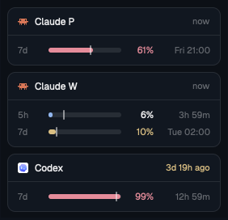

# Limits

A side panel that shows how much of your Claude and Codex subscription limits you have used. There is one card per Claude account and one for Codex. Each limit window is a bar with a mark for how far into the window you are, so you can see at a glance whether you will run out before the reset.

Before you add this: the mod runs a shell script every 30 seconds, reads files outside its own folder (`~/.claude*`, `~/.codex/sessions`, `/tmp/claude`), reads the Claude OAuth token from the macOS Keychain or `.credentials.json`, and sends that token to `api.anthropic.com` to ask for the usage numbers.

## What you see

The panel has the `chrome` color as its background, 8px padding left, right and below, and 8px between cards. It has no top padding, because it sits right under the Vitals mod. It scrolls when the cards do not fit.

Each card has the `background` color, a 1px `border` outline and 10px corners:

- A headline row, 34px high, with a 1px line below it: the program icon (13px, `icons/claude.svg` or `icons/codex.svg` from Herdr's shipped icons), the name in semibold ("Claude P", "Claude W", "Codex"), and on the right when the numbers were last read ("now", "7m ago", "3d 10h ago") in 11px `dim` text. Older than one hour, that text is `ansi3` (yellow).
- One row per limit window, 20px high: the window label ("5h", "7d") in 11px `dim` text, a 6px rounded bar, the percent used right-aligned in a 32px column, and the reset right-aligned in a 62px column. The reset is a countdown ("1h 05m") inside the last 24 hours, else weekday and time ("Tue 02:00").
- On the bar, a 2px wide, 12px high mark in the foreground color at 55% opacity shows the share of the window that has passed.

A bar is `accent` while things are fine. It is `ansi3` from 70% used, or when the current pace would reach 85% by the reset. It is `ansi1` (red) from 90% used, or when the pace would reach 100%. A window whose reset time has passed shows 0% and the text "reset" in `dim`.

A card without data shows "no data yet". If the script itself fails, every card shows "cannot read".

A Claude account is a config folder: `~/.claude` and every `~/.claude-*` that has a `settings.json` and a `projects` folder. The card name is "Claude" plus the first letter after the dash, in upper case. `~/.claude` gets a card only when it has a login or cached numbers.

## How it behaves

- The mod reads every 30 seconds. It redraws when the data changed or the minute turned, so countdowns and pace marks move.
- Hovering a row shows a tooltip: the percent used, the reset as time and countdown, and "At this pace: N% by the reset".
- Hovering the age text says when the limits were last read.
- Clicking a Claude card opens `https://claude.ai/settings/usage`. Clicking the Codex card opens `https://chatgpt.com/codex/settings/usage`.
- Nothing reacts to agent status and there are no keys.

## Built from

Two files in `mods/limits/`: `main.js` (the view) and `data.js` (the shell script, parsers and window maths, no Herdr imports, so plain Node can test them). `mod.json` is `{ "place": "none", "title": "Limits" }`, so a layout has to name the mod. In the layout it came from, it is a 260px high block under Vitals.

From `herdr`: `exec`, `theme()`. From the kit: `View`, `div`, `image`, `v_flex`, `h_flex`, `cx.timer.every`, `cx.spawn`, `cx.notify`. Programs: `sh`, `curl`, `security` (macOS), `sed`, `awk`, `stat`, `shasum` or `sha256sum`, and `open` for the clicks.

One shell call does everything:

- For each Claude account, the numbers are in a cache file `/tmp/claude/statusline-usage[-<hash>].json`. `<hash>` is the first 8 hex characters of the SHA-256 of the config folder path; `~/.claude` has no hash. The file holds `five_hour` and `seven_day` objects with `utilization` (percent) and `resets_at` (ISO time or epoch seconds).
- When that file is missing or older than 5 minutes, the script fetches it: `GET https://api.anthropic.com/api/oauth/usage` with `Authorization: Bearer <token>` and `anthropic-beta: oauth-2025-04-20`. The token is `claudeAiOauth.accessToken` from the Keychain item `Claude Code-credentials[-<hash>]` (accounts tried: the login name, then "Claude Code"), or from `<config folder>/.credentials.json`.
- A status line script may write the same cache file from the `rate_limits` Claude Code hands it. Then the mod makes no request while the file is fresh.
- Codex: the last line that contains `"rate_limits":{` in the newest rollout file under `~/.codex/sessions/<y>/<m>/<d>/`. The script looks at the three newest day folders, the ten newest files, and the last 4 MB of each. The window length comes from `window_minutes` (300 is "5h", 10080 is "7d").

Pace is `used / passed`, where `passed` is the share of the window behind you. It is not computed in the first 5% of a window.

## Watch out

- The credential blob also holds tokens for MCP servers under `mcpOAuth`. Take only the token inside `claudeAiOauth`, and check that it starts with `sk-ant-oat`. A greedy match on `"accessToken"` picks the wrong one and would send it to Anthropic.
- Give the token to curl on stdin (`curl -K -`), not as an argument, so it does not show in `ps`. Never echo it.
- Skip a token whose `expiresAt` is less than a minute away. The mod does not refresh tokens; Claude Code does that when it runs.
- After a failed request, write the wait in seconds into `<cache file>.backoff` (the `Retry-After` header, else 300) and do not ask again inside that time. Retrying early keeps the account locked out.
- Write the cache through a temp file and `mv`, so a reader never sees half a file.
- The usage endpoint is not documented. It may change.
- `stat -c %Y` first, then `stat -f %m`: GNU stat accepts `-f` and prints something else.
- Codex lines with both windows null (`limit_id` "premium") carry no limits. Skip them, or they hide the real line before them.
- A long Codex session keeps writing into the folder of the day it started, so sort the recent files by modification time, not by folder.
- Config folders outside `~/.claude` and `~/.claude-*` are not found.
- Tested on macOS only. The Linux path (`.credentials.json`, `sha256sum`) is written but not run.

## Done when

- `herdr-app check mods/limits` passes and `herdr-app status` lists no error.
- `node --test mods/limits/tests/limits.test.mjs` passes. The tests run the script against a fake home with stub `curl` and `security` commands and check that only the Claude token is sent and that it never appears in the output.
- Each logged-in Claude account has a card with a "5h" and a "7d" row, and the age text says "now" after a fetch.
- With an empty `/tmp/claude`, the cards fill within 30 seconds and one cache file per account appears there.
- The Codex card shows the window from the newest rollout file.
- A click on a card opens the usage page in the browser.
