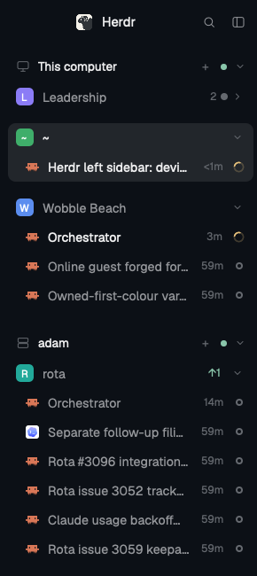

# Spaces+

One sidebar list in place of Herdr's two (spaces on top, agents below). Devices hold spaces, and each space shows its agents right under it, most urgent first. A space or a device folds, and when folded it still says how many agents wait inside and how urgent the most urgent one is.

## What you see

The list has the `chrome` color as its background, 8px side padding and 8px at the top. It scrolls when it does not fit. There is no header: a new space comes from the `+` on a device row.

Below it, top to bottom:

- **Device row**, 28px, only when more than this computer is known: `monitor.svg` (this computer) or `server.svg` (others) at 15px, the name in 12.5px `dim` text, 8px apart, then `+` (new space there), a 6px connection dot (`ansi2` connected, `dim` not) and a fold chevron. 20px above every device after the first, 2px below each device row.
- **Space row**, 30px (28px for a worktree space), `rounded 8`: the shipped spaces row, a colored 18px letter tile (or a branch icon for a worktree nested under its repo), the name, the git tail (repo or branch only when unusual, ↑ahead in `ansi2`, ↓behind in `ansi1`) and a fold chevron at the right end. `selected` background on the active space. 12px between space blocks.
- **Agent row**, 30px, `px 8` plus 10px more on the left, `gap 9`, `rounded 8`: the program icon (16px), the name (the tab's name or the agent's own title; muted when idle and not focused), the time since its state last changed ("3m", 11px `dim`) and its status mark. `selected` background when focused.
- **Sub-agent row**, 26px: tree lines in `input`, a 14px icon, the name in `muted`, the status mark. Under its parent, which has a chevron that folds them.
- **"no agents"**, 30px, italic `dim`, at agent indent, when a space has none.

Status marks: working is `spinner.svg` turning once every 900ms in `working`; blocked is a "Needs you" pill (`blocked` text on `blocked` at 15%); done is a 7px dot in `done`; idle is a 7px ring in `idle`.

Folded space: its agent rows and its worktree spaces are hidden. Left of the chevron: the number of agents (its own and its worktree spaces') in 11px `dim`, then a 7px dot in the most urgent status color. Folded device: the same over all its spaces, left of the connection dot.

Narrow rail (sidebar under 160px): one 32px cell per space with its number, and a 6px dot at its top-right when an agent inside is blocked, done or working. A `»` at the bottom widens the sidebar again.

## How it behaves

- Spaces stay in the order they were dragged into. Status never moves a space.
- Inside a space: pinned agents first, then blocked, done, working, idle; between equals, the one whose state changed last comes first. A parent agent counts as urgent as its most urgent sub-agent.
- A done agent turns idle once someone looks at it, and moves down with the idle ones.
- Hovering an agent row swaps its time for a pin button (`pin.svg`, "Pin to the top"; `pin-off.svg`, "Unpin"). Pinned means first in its own space. There is no mark on a pinned agent at rest.
- Click an agent: its pane gets focus. Click a sub-agent: its pane, or a peek when it has none.
- Click a space: select it. Drag a space onto another of the same device: move it there. Right-click a space: the space menu. Click its chevron: fold or unfold (does not select).
- Hover "no agents": "+ terminal" shows. Click: a new tab with a terminal in that space, in the folder its first terminal is in now. On a device that is loading or unavailable the row does nothing.
- `agent.next` / `agent.prev` walk the agents in the order of the list, folded ones included.
- Folds are kept across restarts.

## Built from

- Layout: the sidebar column's `sidebar-lists` column (the `spaces` and `agents` blocks) is replaced by one block `{ "id": "sidebar-list", "type": "block", "content": { "mod": "spaces-plus" }, "size": { "weight": 1 }, "min": 90 }`.
- `mods/spaces-plus/main.js` is a `mod.clone` of the shipped `spaces` mod (Herdr 0.1.15) with the row, sub-agent tree, pin, status and naming code of the shipped `agents` mod ported in. `order.js` holds the sort, grouping and fold summary rules without Herdr imports, so `node --test` covers them.
- Reads `spaces()`, `machines()`, `panes()`, `agents()`, `terminals()`, `focused()`, `layout()`, `theme()`, `shared("space.colors")`. Calls `space.select`, `space.move`, `space.new`, `pane.focus`, `terminal.peek`, `terminal.pin`, `tab.new`, `layout.resize`, `setAgentOrder`. Runs `git` (branch, ahead/behind) and `hc machine ls/rm/add` as the shipped spaces mod does.
- Icons come from `mods/workspace-chrome/` (`monitor`, `server`, `branch`, `chevron-down`, `chevron-right`, `spinner`, `pin`, `pin-off`, `plus`).
- localStorage keys: `machines.folded`, `machines.reconnecting` (as in spaces), `spaces.folded`, `changed`, `pins` (as in agents).

## Watch out

- Herdr does not reload a mod through a symlink. After an edit, run `./install.sh` again.
- A new space stays hidden for up to 1.5 s while git answers, so a worktree lands under its repo. Its agents stay hidden with it.
- Remote ids carry the machine: a remote agent's `space` is `adam/sp…`. Group by the id exactly as given.
- The mod's localStorage lives in memory while the app runs; editing `data/spaces-plus/store.json` by hand only sticks while no copy of the mod is open.
- The "3m" ages start fresh the first time, because the agents mod's timestamps are in that mod's storage.
- If another mod in the layout also calls `setAgentOrder` (the shipped `agents` mod), the last one to draw wins.

## Done when

- `herdr-app check ~/.config/herdr-app/mods/spaces-plus` passes and `herdr-app status` shows no errors.
- `node --test spaces-plus/mods/spaces-plus/tests/order.test.mjs` passes.
- In one space, a blocked, a done, a working and an idle agent show in that order, and a pinned idle agent shows above them.
- Pinning from the hover button moves the agent to the top of its own space only.
- `agent.next` walks the agents in the list's order.
- Folding a space hides its agents and shows the count and dot; the fold survives a reload.
- A click on "no agents" opens a terminal tab in that space's folder.
- Dragging a space still reorders it, worktree spaces still nest, a remote device still folds and shows its reconnect and login rows.
- In the rail, space numbers carry status dots and `»` widens the sidebar.
