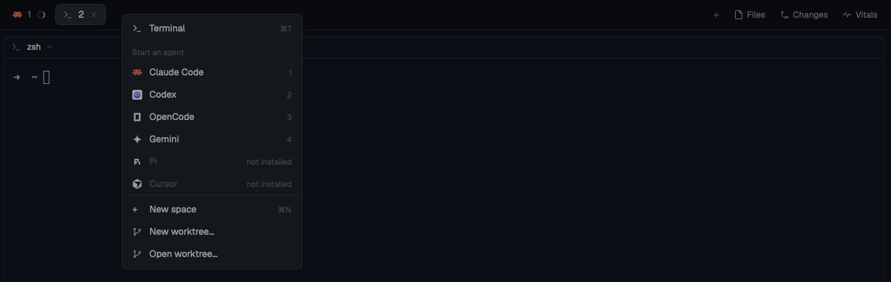

# Tabs bar right-click

Herdr's tab bar with three changes: a right-click on the empty bar next to the tabs opens the same "new" menu as the `+` button, the side panel (Files, Changes, Vitals) is remembered per space, and a Vitals button opens the vitals panel.

## What you see

One row, 42px high in the layout, `chrome` background, a 1px `border` line at the bottom. 10px padding on the right; on macOS without a title bar the left padding leaves room for the traffic lights (at least 10px).

Left to right:

- **Tabs**, in a row that scrolls sideways. Each tab is 29px high, `px 10`, `gap 7`, `rounded 7`, 12.8px text. The active tab has the `raised` background and a 1px `border` outline, `foreground` text; the others have `chrome` and `muted` text. A tab shows its program's icon (14px), its name (the program's name while the tab has an automatic name, max 170px, truncated; "Z" after it when zoomed), a `working` spinner while an agent works, a 6px dot in `blocked` or `done`, and on the active tab a close icon.
- **`+`**, 26px square, `dim`, `rounded 6`.
- **Panel buttons**: "Files", "Changes" (only when enabled in Herdr's settings) and "Vitals", each 26px high, `px 8`, 12px text with a 14px icon. The open one has the `selected` background.
- On Windows (and wherever the window draws its own buttons): minimize, maximize/restore and close.

## How it behaves

- **Right-click the empty bar next to the tabs:** the `new-menu` popup opens (250×512), the same one the `+` opens. A right-click on a tab still opens that tab's own menu.
- Click a tab: select it. Drag it onto another: move it there. Double-click it: rename it. Scroll on the bar: previous or next tab.
- A panel button opens that panel, or closes it when it is already open.
- The side panel is remembered per space: switching to a space opens the panel it had (or closes it, when it had none). A space never seen before keeps whatever is shown.

## Built from

- Layout: the block above the work area, `{ "id": "tabs", "type": "block", "content": { "mod": "tabs-bar-rightclick" }, "size": { "px": 42 }, "window_drag": true }`. The panel buttons expect a column `panel` holding a stack `panel-body` with children `files`, `changes` and `vitals` (see the vitals section of the README).
- `mods/tabs-bar-rightclick/main.js` is a `mod.clone` of the shipped `tabs` mod (Herdr 0.1.12), changed.
- Reads `spaces()`, `panes()`, `layout()`, `window()`, `settings()`, `theme()`, `shared("workspace.panels")`. Calls `tab.select`, `tab.move`, `tab.rename`, `tab.close`, `tab.prev`, `tab.next`, `layout.select`, `layout.show`, `layout.hide`, the window commands, and `openOverlay` for `menu` and `new-menu`.
- Its own icons: `vitals.svg` and the four Windows `win-*.svg`. `mods/pane/close.svg`, `mods/files/file.svg`, `mods/changes/changes.svg` and `mods/workspace-chrome/spinner.svg` come from the shipped mods.
- localStorage key `panels`: space id → open panel.

## Watch out

- The right-click handler sits on the tab row, and each tab stops its own right-click, so the two menus never both open.
- The popup opens where Herdr puts the `+` button's popup; no position is passed.
- The Vitals button is always shown; without the vitals mod in the layout it opens an empty panel.

## Done when

- `herdr-app check ~/.config/herdr-app/mods/tabs-bar-rightclick` passes.
- A right-click on the empty bar opens the "new" menu; a right-click on a tab opens the tab menu.
- Switching between two spaces, one with Files open and one with no panel, restores each.
