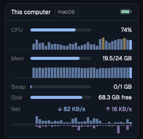

# Vitals

A side panel that shows how busy each computer is. There is one card for this computer and one for every machine connected in Herdr. A card shows CPU, memory, swap, disk and network, with small live graphs under CPU, memory and network.

## What you see

The panel has the `chrome` color as its background, 8px padding and 8px between cards. It scrolls when the cards do not fit.

Each card has the `background` color, a 1px `border` outline and 10px corners. From top to bottom:

- A headline row, 34px high, with a 1px line below it. On the left the machine name in semibold ("This computer" for the local one), then the OS ("macOS" or "Linux") as a small outlined pill in 10px `muted` text. On the right, on a Mac, a drawn battery: a 20x10px outline with a fill for the level and a 2px nub. The fill is `ansi2` (green) on AC and `muted` on battery. At 15% or less on battery the outline, fill and number are `ansi1` (red). The percent number stands left of the icon, except for a full battery on AC.
- CPU row, 20px high: the label "CPU" in 11px `dim` text (30px wide), a 6px rounded bar, and the value right-aligned in a 72px column ("23%").
- CPU graph, 26px high: 40 thin bars, one per sample, newest on the right. The newest bar is fully opaque, older ones are at 60%. Samples that do not exist yet are 1px `border` dashes.
- Mem row with a bar and "14.2/24 GB", then a memory graph like the CPU one, in percent of total memory.
- Swap row with a bar and "1.2/2 GB", or "none" in `dim` when the system has no swap.
- Disk row with a bar for the used share and "63 GB free".
- Net row: the label, then "↓ 1.2 MB/s" in `accent` and "↑ 340 KB/s" in `ansi5`, each right-aligned in an 84px column.
- Net graph: download bars 16px high growing up, a 1px `border` line, upload bars 16px high hanging down. Both use one scale: the largest value in the 40 samples, and never less than 100 KB/s.

Bars and values are `accent` and plain text while things are normal. CPU, swap and disk turn `ansi3` (yellow) from 85% (disk: 90%) and `ansi1` (red) from 95%. Memory follows the memory pressure the system reports: `ansi3` for warning, `ansi1` for critical.

A machine that is offline keeps its card at half opacity with the text "offline". An OS other than macOS or Linux shows "unsupported (<name>)". Before the first sample a card shows "…".

## How it behaves

- It takes a sample every 3 seconds while the Herdr window is in front and the Vitals tab is visible, and every 30 seconds otherwise. Graphs keep the last 40 samples.
- The network rate is the difference between two samples, so the first sample shows "…" for both directions.
- Hovering the CPU row shows a tooltip "Most CPU lately:" with the three busiest processes. The process list is read only on hover.
- Hovering the Mem row shows the memory pressure. Hovering Swap shows the percent used. Hovering Net shows the current graph scale. Hovering the battery shows percent, charge state and AC.
- Clicking the local card on a Mac opens Activity Monitor.
- Nothing reacts to agent status and there are no keys.

## Built from

Two files in `mods/vitals/`: `main.js` (the view) and `stats.js` (shell scripts and pure parsers, no Herdr imports, so plain Node can test them). `mod.json` is `{ "place": "none", "title": "Vitals" }`, so a layout has to name the mod. `vitals.svg` is a pulse-line icon for the tab.

From `herdr`: `exec` (with `{ on: <machine name> }` for remote machines), `machines()`, `layout()`, `window()`, `theme()`. From the kit: `View`, `div`, `v_flex`, `h_flex`, `cx.timer.every`, `cx.spawn`, `cx.notify`. The graphs are rows of flex `div`s; there is no chart element.

One shell call per machine per sample, with `LC_ALL=C`:

- macOS: `iostat -n 0 -c 2 -w 1` (CPU, last row), `vm_stat`, `sysctl -n hw.memsize kern.memorystatus_vm_pressure_level vm.swapusage`, `df -k /`, `pmset -g batt`, `netstat -ibn`.
- Linux: `/proc/stat` (CPU is the delta between two samples), `/proc/meminfo`, `/proc/pressure/memory`, `df -kP /`, `/proc/net/dev`.
- On hover: `ps` sorted by CPU, first six lines.

Memory used on macOS is anonymous pages minus purgeable, plus wired, plus compressor pages. That matches "Memory Used" in Activity Monitor.

The mod decides "visible" from the layout: a node with the id `panel` that is not hidden, and a node `panel-body` whose `active` is `vitals`.

## Watch out

- Force the C locale. A German locale prints `2073,25M` and breaks every number.
- In `netstat -ibn` the address column can be empty, so read `Ibytes` and `Obytes` counted from the end of the row. Use only the `<Link#n>` rows, or every interface is counted once per address.
- Count physical interfaces only: `en*` on macOS; on Linux everything except `lo`, `veth*`, `docker*`, `br-*`, `virbr*`, `tun*`, `tap*`, `tailscale*`, `wg*`, `zt*`. Otherwise VPN and container traffic is counted twice.
- Push one entry into every history on every sample, `null` when a value is missing. If not, the graphs drift apart in time.
- After a failed sample, drop the previous CPU and network counters. A delta across the gap is wrong.
- A counter that went backwards (reboot, interface reset) gives no rate, not a negative one.
- Theme colors are hex strings; the older graph bars append `99` for 60% opacity.
- In the background the 30 second rate makes the time steps in the graphs uneven.
- With other layout ids than `panel` and `panel-body` the mod works, but always at the 30 second rate.
- The linux PSI thresholds (10 for warning, 40 for critical, on `some avg10`) are a judgment call.

## Done when

- `herdr-app check mods/vitals` passes and `herdr-app status` lists no error.
- `node --test mods/vitals/tests/vitals.test.mjs` passes.
- The local card shows five rows and three graphs, and a new bar appears every 3 seconds while the tab is in front.
- A download makes the upper half of the network graph rise and the "↓" value change.
- A connected Linux machine has its own card with the "Linux" pill and no battery.
- Unplugging the Mac at less than 100% shows the percent next to the battery icon.
